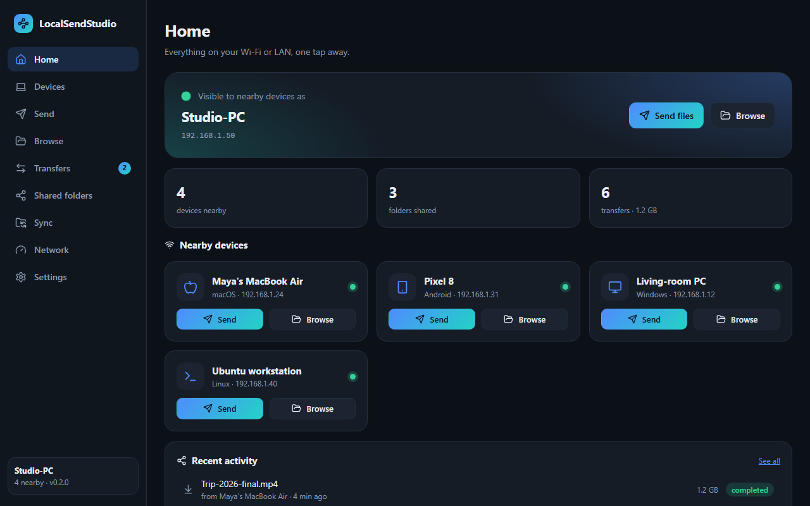
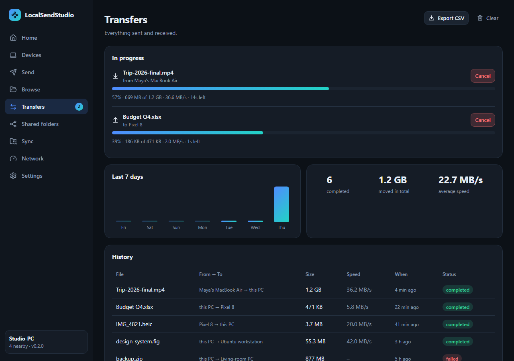
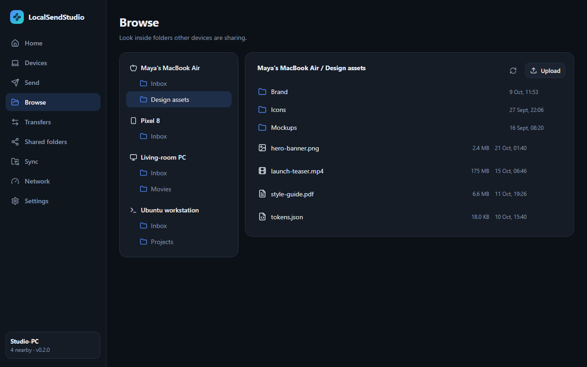
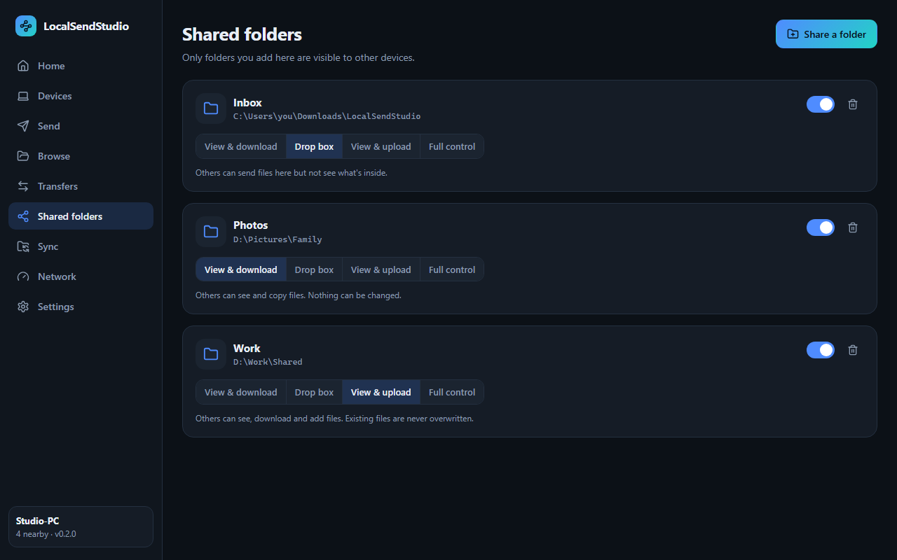
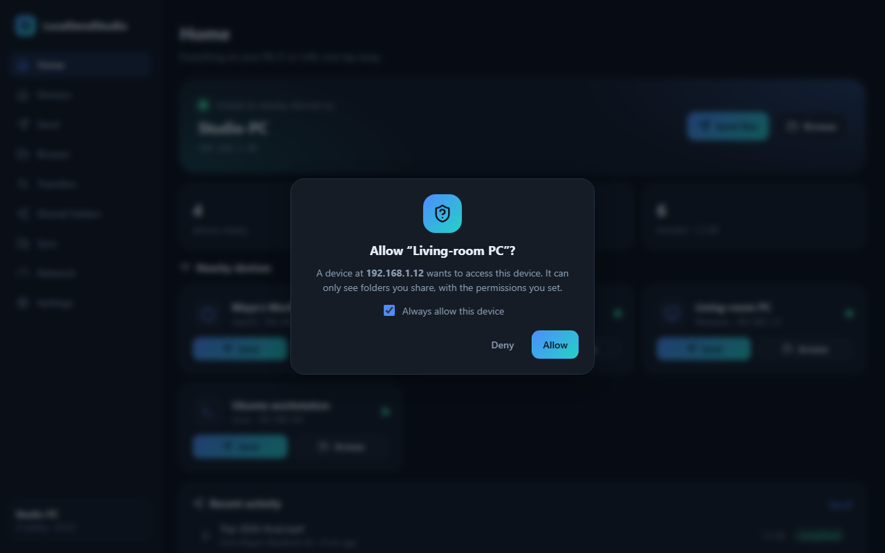
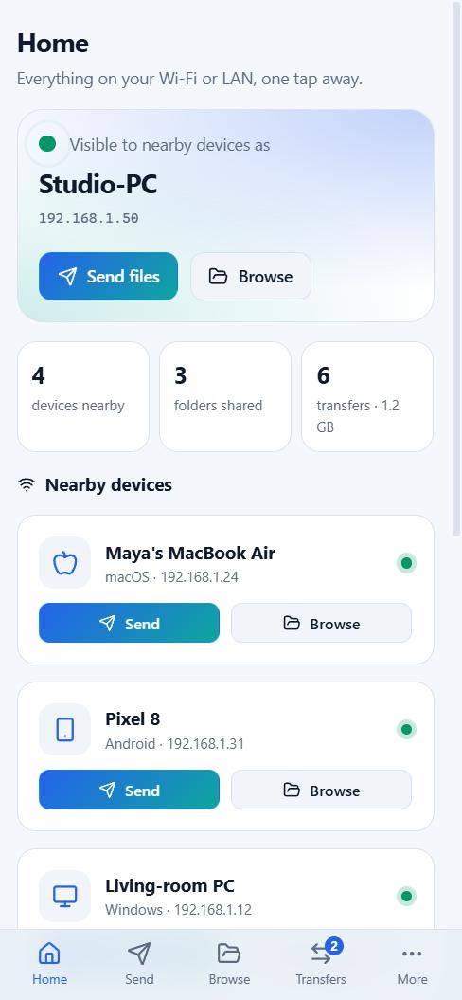
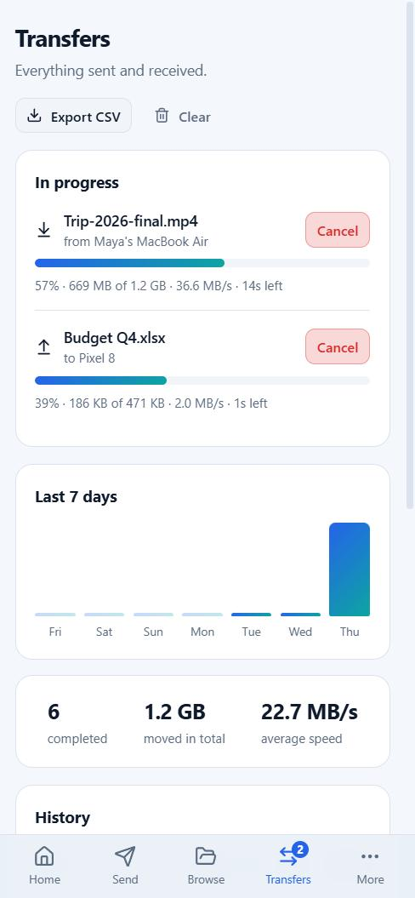

# LocalSendStudio

**Send files between your devices over Wi-Fi or LAN. No account, no cloud, no internet.**

Open the app on two devices on the same network, pick files, tap send. The other device is asked before anything arrives.

<p align="center">
  
</p>

## Download

Get the latest build from **[Releases](https://github.com/unupunct/LocalSendStudio/releases/latest)**.

| Platform | File | Notes |
|---|---|---|
| Windows 10/11 | `LocalSendStudio_*_x64-setup.exe` (or `.msi`) | Unsigned: SmartScreen shows a warning, choose *More info → Run anyway* |
| macOS 10.15+ (Intel and Apple silicon) | `LocalSendStudio_*_universal.dmg` | Unsigned: see [macOS install](docs/INSTALL.md#macos) |
| Linux | `.deb`, `.rpm`, `.AppImage`, or the [install script](docs/INSTALL-LINUX.md) | One-line installer for Debian/Ubuntu, Fedora/openSUSE and everything else |
| Android 7+ | `LocalSendStudio_*_android.apk` | Sideload; see [Android install](docs/INSTALL.md#android) |

**Linux, one line:**

```bash
curl -fsSL https://raw.githubusercontent.com/unupunct/LocalSendStudio/main/scripts/install-linux.sh | bash
```

Step-by-step instructions for every platform: [docs/INSTALL.md](docs/INSTALL.md) · Linux tutorial: [docs/INSTALL-LINUX.md](docs/INSTALL-LINUX.md).

## What it does

- **Send** files to one or several devices. Drag and drop, or pick files.
- **Inbox**: every device gets a receive-only folder on first run, so sending works with no setup.
- **Share folders** with one of four access levels (view & download, drop box, view & upload, full control). New folders start read-only.
- **Browse** other devices' shared folders. Download, upload, make folders, rename and delete (only where permitted).
- **Approval prompt**: an unknown device must be approved before it can touch anything. Approved devices are remembered and can be revoked.
- **Checked transfers**: every file is verified with SHA-256, written to a temporary file and moved into place only when it matches. Interrupted downloads resume. Uploads never overwrite existing files (`name (1).ext`).
- **Discovery** over multicast and per-interface broadcast, plus **Add by IP** for networks that block discovery.
- **Sync** a folder to or from another device (copies what's missing, never deletes).
- **Network check** that tells you why a device can't be found, plus a speed test.
- Runs in the **system tray** on desktop, light and dark themes, phone-friendly layout.

<table>
<tr>
<td></td>
<td></td>
</tr>
<tr>
<td></td>
<td></td>
</tr>
</table>

<p align="center">
  
  &nbsp;
  
</p>

## Security, honestly

- The first time a device connects you get an **Allow / Deny** prompt (default mode *Ask first*). Only folders you share are reachable, with the permissions you set.
- Paths are validated against traversal, Windows tricks (`C:`, `::$DATA`, `CON`…) and symlinks that leave a shared folder. This is covered by automated tests.
- **Transfers are not encrypted.** They are integrity-checked (SHA-256) but readable by someone who can capture traffic on your network. Don't use it on networks you don't trust.
- Devices are recognised by a random ID they announce; there is no cryptographic proof of identity yet, so on a hostile LAN a device could pretend to be one you approved. Encryption and device pairing are the next planned security step.
- *Trust everyone* mode exists for fully private networks and warns you before it turns on.

Details: [docs/SECURITY.md](docs/SECURITY.md).

## Build from source

You need Rust (stable), Node.js 20+ and the [Tauri prerequisites](https://tauri.app/start/prerequisites/) for your OS.

```bash
git clone https://github.com/unupunct/LocalSendStudio.git
cd LocalSendStudio
npm install
npm run tauri dev      # run
npm run tauri build    # installers land in src-tauri/target/release/bundle/
cd src-tauri && cargo test --lib   # 19 tests: protocol, path safety, transfers, permissions
```

See [docs/BUILD.md](docs/BUILD.md) for Linux packages, macOS, and building the Android APK.

## Documentation

[Install](docs/INSTALL.md) · [Linux tutorial](docs/INSTALL-LINUX.md) · [Troubleshooting](docs/TROUBLESHOOTING.md) · [Security](docs/SECURITY.md) · [Architecture](docs/ARCHITECTURE.md) · [Protocol](docs/PROTOCOL.md) · [Build](docs/BUILD.md) · [Changelog](CHANGELOG.md) · [Contributing](CONTRIBUTING.md)

## Not included yet

iOS, encryption, device pairing, automatic two-way sync, clipboard sharing. Android can't receive while the app is closed.

## License

MIT — see [LICENSE](LICENSE).
